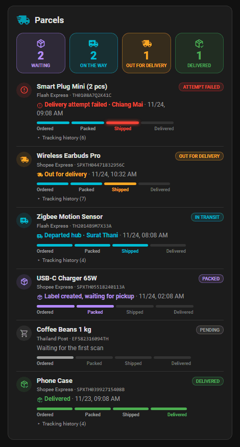
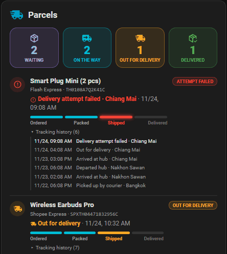
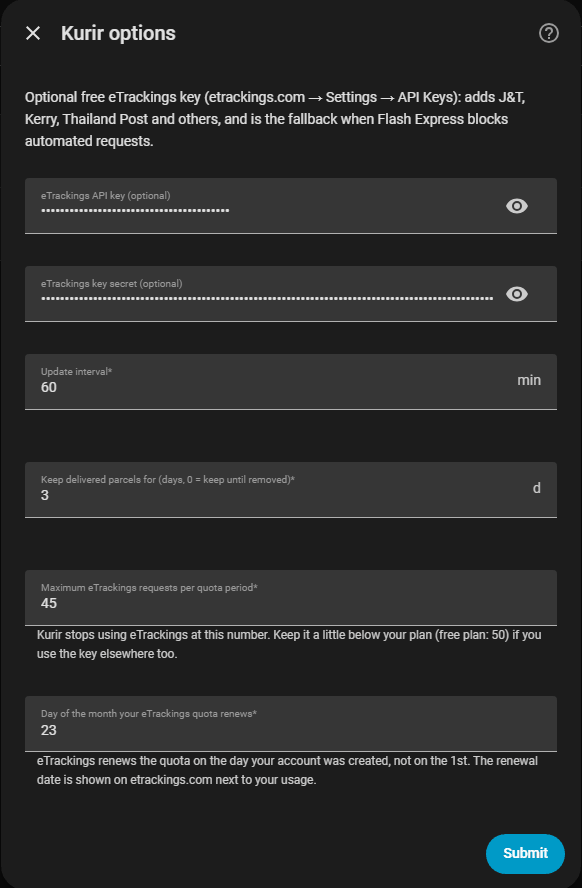
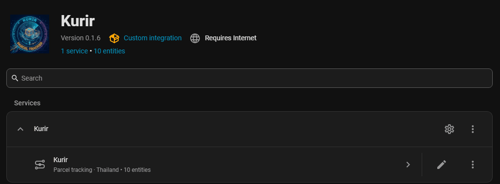

<p align="center">
  
</p>

<p align="center"><b>Last-mile parcel tracking for Southeast Asia in Home Assistant</b><br>
Flash Express · Shopee Express (SPX) · more couriers through eTrackings</p>

<p align="center">
  <a href="https://github.com/hacs/integration"></a>
  
  <a href="https://github.com/mb26-dev/ha-kurir/releases"></a>
  <a href="https://ko-fi.com/mb26dev"></a>
</p>

Shopping on Lazada or Shopee means your parcel travels with Flash Express, Shopee Express or another local courier, and the only way to see where it is has been to open the shop app. **Kurir** brings the live courier scans into Home Assistant: every hub, every departure, *out for delivery* and – most important – **a failed delivery attempt**, so you know before the parcel goes back.

## Features

- **Live status per parcel** – last scan with place and time, a 4-step progress bar (Ordered → Packed → Shipped → Delivered) and the full scan history.
- **Readable places** – Thai province names and the Chinese place names of cross-border parcels (e.g. `浙江,嘉兴市`) are shown in English (`Zhejiang, Jiaxing`); unknown Chinese places show as `China`.
- **Failed delivery attempts** are a status of their own (`failed_attempt`) and are shown in red.
- **Events for automations** – `kurir_parcel_update` fires on every new scan, with status, event, place and time. Build your own phone notifications from it.
- **Add parcels from any text** – `kurir.add_from_text` finds tracking numbers in an e-mail body or a push notification and starts tracking them.
- **No account needed** for Flash Express and Shopee Express. They are queried through their public tracking pages, at most once per update interval (default: hourly).
- **Optional eTrackings key** (free plan: 50 requests/month) adds J&T, Kerry, Thailand Post, DHL eCommerce, Ninja Van, Best Express and is used as a fallback when Flash Express blocks automated requests. Kurir keeps a budget per quota period so the free plan is never exceeded, and spreads it evenly over the days left (parcels that waited longest are asked first), so the quota is not gone after one day of Flash blocking.
- **Lovelace card included** – `custom:kurir-card`, phone friendly, follows your theme.
- **Speaks your language** – setup, options, states, the card and the courier events are translated into English, Thai, Vietnamese, Indonesian, Malay, Simplified Chinese and German, following your Home Assistant language.
- Delivered parcels are removed automatically after a few days (configurable).

## Screenshots

<table>
  <tr>
    <td align="center" valign="top" width="50%">
      <br>
      <sub><b>Kurir card</b> – every parcel with courier, last scan, place and progress. A failed delivery attempt is shown in red.</sub>
    </td>
    <td align="center" valign="top" width="50%">
      <br>
      <sub><b>Scan history</b> – tap a parcel to see every hub, departure and arrival.</sub>
    </td>
  </tr>
  <tr>
    <td align="center" valign="top" width="50%">
      <br>
      <sub><b>Options</b> – update interval, eTrackings key, monthly limit and the day the quota renews.</sub>
    </td>
    <td align="center" valign="top" width="50%">
      <br>
      <sub><b>Integration</b> – one device with a sensor per parcel plus the summary sensors.</sub>
    </td>
  </tr>
</table>

<sub>The screenshots use demo parcels; tracking numbers and places are made up.</sub>

## Couriers and countries

| Courier | Countries | How | Status |
|---|---|---|---|
| Shopee Express (SPX) | 🇹🇭 Thailand, 🇲🇾 Malaysia, 🇻🇳 Vietnam, 🇵🇭 Philippines, 🇸🇬 Singapore | public tracking API, no key | verified |
| Shopee Express (SPX) | 🇮🇩 Indonesia | public tracking API, no key | not verified yet – feedback welcome |
| Flash Express | 🇹🇭 Thailand | public tracking API, no key; eTrackings fallback | verified |
| J&T, Kerry, Thailand Post, DHL eCommerce, Ninja Van, Best | 🇹🇭 Thailand | eTrackings API key | via eTrackings |

The courier is detected from the tracking number (`SPXTH…`, `SPXMY…`, `TH…`, `EF123456789TH` …). For other numbers pass `carrier` when adding the parcel.

> **Note:** Flash Express and SPX have no official API for recipients. Kurir uses the same endpoints as their public tracking pages. If a courier changes them, tracking for that courier stops until Kurir is updated. Flash Express sometimes answers with a browser check instead of data – Kurir does **not** try to get around it; the parcel keeps its last status, or eTrackings is used if you configured a key.

## Installation

### HACS (recommended)

Kurir is available in the HACS default store.

[](https://my.home-assistant.io/redirect/hacs_repository/?owner=mb26-dev&repository=ha-kurir&category=integration)

1. Open **HACS** in Home Assistant, search for **Kurir** and install it.
2. Restart Home Assistant.
3. **Settings → Devices & services → Add integration → Kurir**.

<details>
<summary>Not showing up in HACS yet? Add it as a custom repository</summary>

1. HACS → ⋮ → **Custom repositories** → add `https://github.com/mb26-dev/ha-kurir`, type **Integration**.
2. Install **Kurir** and restart Home Assistant.

</details>

### Manual

Copy `custom_components/kurir` into your `config/custom_components/` folder and restart Home Assistant.

## Configuration

| Field | Description |
|---|---|
| Country | Your country. Used for SPX numbers without a country code and for Flash Express. |
| eTrackings API key / key secret | Optional. Free account at [etrackings.com](https://etrackings.com) → Settings → API Keys. |

Options (⚙️ on the integration):

| Option | Default | Description |
|---|---|---|
| eTrackings API key / key secret | – | Can be added or changed here at any time. |
| Update interval | 60 min | Minimum 30 min. |
| Keep delivered parcels | 3 days | `0` keeps them until you remove them. |
| Maximum eTrackings requests per quota period | 45 | Kurir stops using eTrackings at this number. |
| Day of the month your eTrackings quota renews | 1 | eTrackings renews the quota on the day your account was created, not on the 1st – the date is shown on etrackings.com next to your usage. Set it here so Kurir's count restarts on the same day. |

> **Using the same eTrackings key somewhere else?** Kurir only counts its own requests. Tell Kurir what is already used with `kurir.set_etrackings_usage` (see below) – the number is reset automatically when the quota renews – or give Kurir a key of its own.

## Usage

### Add a parcel

```yaml
action: kurir.add_parcel
data:
  tracking_number: SPXTH06735947878B
  name: Broadlink RM4C mini
```

### Add parcels from text (e-mail, push notification)

```yaml
action: kurir.add_from_text
data:
  text: "{{ trigger.event.data.text }}"
  name: "{{ trigger.event.data.subject }}"
```

Both actions return a response (`added`, `found`) you can use with `response_variable`.

### Remove / refresh

```yaml
action: kurir.remove_parcel
data:
  tracking_number: SPXTH06735947878B
```

```yaml
action: kurir.refresh
```

### Correct the eTrackings count

Kurir counts only its own eTrackings requests. If the same key was used elsewhere in this quota period, set the number shown on etrackings.com. It goes back to 0 by itself when the quota renews.

```yaml
action: kurir.set_etrackings_usage
data:
  used: 27
```

## Entities

- **`sensor.kurir_parcels_on_the_way`** – number of parcels not yet delivered. Attributes: `parcels` (list used by the card), `counts` per status, `flash_blocked`, `etrackings_used_this_month` (requests in the current quota period), `etrackings_limit`, `etrackings_quota_renews`, `etrackings_today` (requests used / allowed today).
- **One sensor per parcel** – state is one of `pending`, `packed`, `in_transit`, `out_for_delivery`, `failed_attempt`, `delivered`, `returned`, `unknown`. Attributes: `tracking_number`, `carrier`, `event`, `location`, `event_time`, `step`, `delivered_at`, `events`.

## Event `kurir_parcel_update`

```yaml
tracking_number: SPXTH06735947878B
name: Broadlink RM4C mini
carrier: spx
carrier_name: Shopee Express
status: out_for_delivery
previous_status: in_transit
event: Out for delivery
location: ""
time: "2026-11-23T03:15:25+00:00"
```

Example – push to your phone when a parcel is out for delivery or a delivery attempt failed:

```yaml
alias: Parcel alerts
triggers:
  - trigger: event
    event_type: kurir_parcel_update
    event_data:
      status: out_for_delivery
  - trigger: event
    event_type: kurir_parcel_update
    event_data:
      status: failed_attempt
actions:
  - action: notify.mobile_app_my_phone
    data:
      title: "📦 {{ trigger.event.data.event }}"
      message: >-
        {{ trigger.event.data.name }} · {{ trigger.event.data.carrier_name }}
        {{ (' · ' ~ trigger.event.data.location) if trigger.event.data.location }}
mode: queued
```

## Card

The card is loaded automatically by the integration – no resource to add.

```yaml
type: custom:kurir-card
entity: sensor.kurir_parcels_on_the_way
title: Parcels
show_delivered: true
show_history: true
max_items: 20
```

## Languages

| Language | Setup & options | Card & courier events |
|---|---|---|
| 🇬🇧 English | ✓ | ✓ |
| 🇹🇭 ไทย (Thai) | ✓ | ✓ |
| 🇻🇳 Tiếng Việt (Vietnamese) | ✓ | ✓ |
| 🇮🇩 Bahasa Indonesia | ✓ | ✓ |
| 🇲🇾 Bahasa Melayu (Malay) | ✓ | ✓ |
| 🇨🇳 简体中文 (Simplified Chinese) | ✓ | ✓ |
| 🇩🇪 Deutsch (German) | ✓ | ✓ |

The card follows the language of your Home Assistant profile. Courier events are stored in English (also in the `kurir_parcel_update` event) and only translated for display. Spotted a clumsy translation? Corrections are very welcome as a pull request or issue.

## Privacy

Kurir only sends the tracking numbers you add to the courier that carries them (or to eTrackings if you configured a key). From the answers it keeps the scan event, place and time. Names, phone numbers and addresses that couriers include in their answers are not stored.

## Support

If Kurir told you about a failed delivery attempt before the parcel went back, a coffee keeps the project moving. ☕📦

<a href="https://ko-fi.com/mb26dev"></a>

A star on GitHub or a bug report helps just as much. Thank you!

Issues and feature requests: [GitHub issues](https://github.com/mb26-dev/ha-kurir/issues). Tested a courier in a country marked "not verified"? Please open an issue with the result.

## License

MIT
